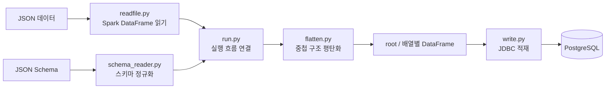

# S2R

**Semi-Structured to Relational** — JSON과 JSON Schema를 입력받아 Spark로 중첩 구조를 평탄화하고, 필요하면 PostgreSQL 테이블로 적재하는 실험 프로젝트입니다.

## Architecture



## Features

- 중첩 `Object`의 스칼라 필드를 `customer.name` 같은 경로 컬럼으로 펼칩니다.
- 각 `Array`를 별도 자식 테이블로 만들고, 부모 ID와 배열 인덱스를 포함합니다.
- JSON Schema의 로컬 `$ref`, 기본 Object·Array·Scalar 구조를 읽습니다.
- `oneOf`는 같은 스칼라 타입의 대안과 MongoDB Extended JSON `Double` 형식을 처리합니다. 그 외 지원하지 않는 혼합 타입 분기는 오류로 알립니다.
- Spark JDBC를 통해 여러 DataFrame을 PostgreSQL 테이블에 저장합니다.

예를 들어 `items`와 `items.tags` 배열이 있는 입력은 `root`, `items`, `items.tags` DataFrame으로 나뉩니다. 기본 PostgreSQL 테이블 이름은 `s2r_root`, `s2r_items`, `s2r_items_tags`입니다.

## Project Structure

```text
S2R/
  readfile.py       # JSON 파일을 Spark DataFrame으로 읽기
  schema_reader.py  # JSON Schema를 내부 스키마 트리로 변환
  flatten.py        # Object와 Array 구조 평탄화
  write.py          # DataFrame을 JDBC 테이블에 저장
  run.py            # 읽기부터 선택적 DB 적재까지 실행
  tests/            # 예제 데이터와 JSON Schema
```

## Requirements

- Python 3.10 이상
- Java 및 PySpark 실행 환경
- PostgreSQL 적재 시 PostgreSQL JDBC 드라이버 JAR

## Quick Start

PySpark가 설치되고 Java 환경이 설정된 Python 환경에서 프로젝트 루트 기준으로 실행합니다.

```bash
python run.py \
  --data tests/sample_supplies.sales.json \
  --schema tests/schema-sample_supplies-sales-standardJSON.json \
  --record-key-path '_id.$oid'
```

`--record-key-path`는 원본에서 root 행의 식별자로 사용할 필드 경로입니다. 생략하면 Spark가 실행 중 ID를 생성합니다.

## PostgreSQL 적재

접속 정보는 환경변수로 설정합니다. 아래 DB 주소와 계정은 실행 환경에 맞게 바꾸세요.

```bash
export S2R_PG_URL='jdbc:postgresql://localhost:5432/stockpipe'
export S2R_PG_USER='your_user'
read -rsp 'PostgreSQL password: ' S2R_PG_PASSWORD
echo
export S2R_PG_PASSWORD
```

```bash
python run.py \
  --data tests/sample_supplies.sales.json \
  --schema tests/schema-sample_supplies-sales-standardJSON.json \
  --record-key-path '_id.$oid' \
  --write-to-postgres \
  --postgres-driver-jar /path/to/postgresql.jar
```

기본 저장 모드는 `errorifexists`입니다. 기존 테이블이 있으면 실행이 중단됩니다. 테스트 전용 테이블을 다시 만들려면 `--write-mode overwrite`를 지정할 수 있습니다. 이 모드는 기존 테이블을 교체하므로 대상 테이블을 확인한 뒤 사용하세요.

## Current Scope

- JSON 파일과 JSON Schema를 입력으로 받는 배치 처리 프로토타입입니다.
- DataFrame 간 부모 키로 조인할 수 있지만, PostgreSQL 외래키 제약조건과 인덱스는 자동 생성하지 않습니다.
- 자식 행 ID는 Spark 실행 중 생성되므로, 별도 키 설계 없이는 재실행 간 동일성을 보장하지 않습니다.
- MongoDB 직접 연결, CDC, XML 입력, 스키마 변경 자동 대응은 현재 범위에 포함되지 않습니다.

## Sample Data and Git

작은 예제 JSON과 스키마는 `tests/`에서 관리합니다. MongoDB archive나 큰 데이터셋은 저장소 크기를 키우므로 Git에 추가하기 전에 크기와 배포 방식을 확인하세요. 접속 비밀번호와 개인 환경 설정은 저장소에 커밋하지 않습니다.

MongoDB sample archive를 사용하는 경우, 먼저 로컬 MongoDB에 복원한 뒤 대상 collection을 JSON 데이터 파일로 내보내고 해당 JSON Schema와 함께 S2R에 전달합니다. S2R은 MongoDB에 직접 접속하지 않습니다.

```bash
docker cp /path/to/sampledata.archive <mongo-container>:/tmp/sampledata.archive

docker exec -it <mongo-container> mongorestore \
  --host 127.0.0.1 \
  --port 27017 \
  --username root \
  --authenticationDatabase admin \
  --nsInclude 'sample_*.*' \
  --archive=/tmp/sampledata.archive
```
